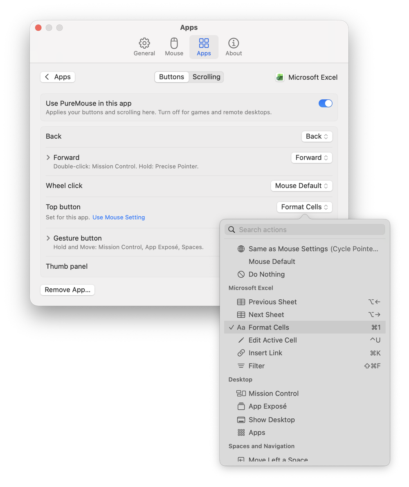
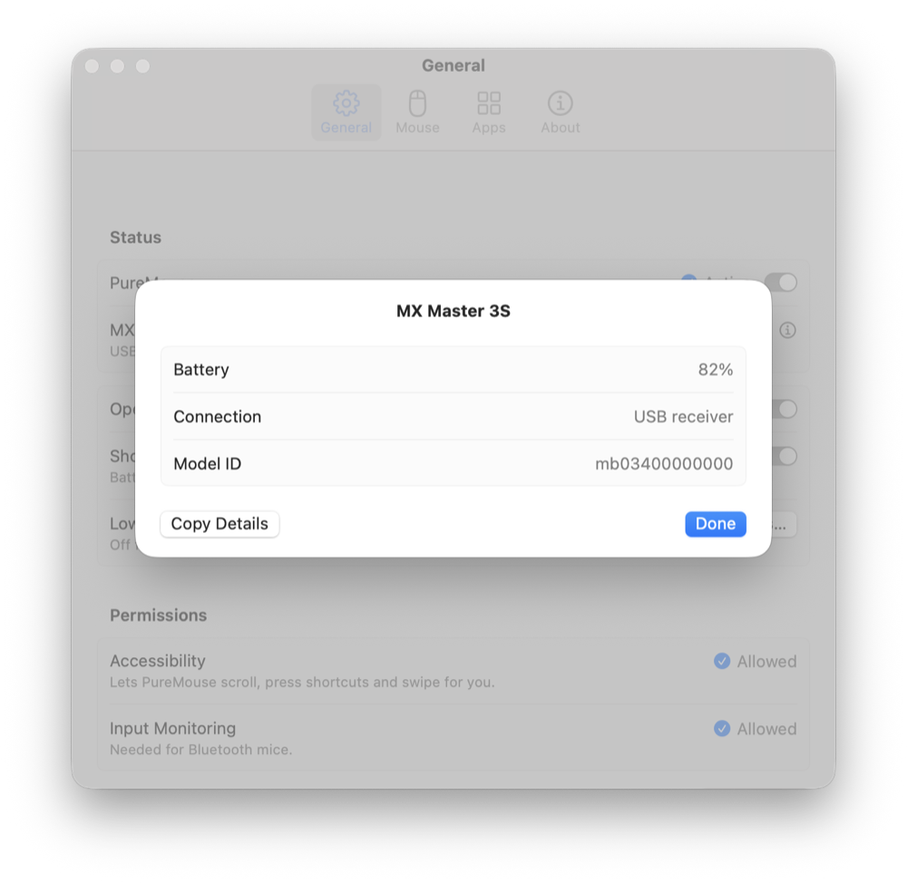
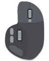
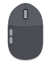

<p align="center">
  <picture>
    <source media="(prefers-color-scheme: dark)" srcset="assets/AppIcon-dark.png">
    
  </picture>
</p>

<h1 align="center">PureMouse</h1>

<p align="center">
  <b>A lightweight, native alternative to Logi Options+ for Logitech mice on macOS.</b><br>
  Buttons, gestures, smooth scrolling, pointer speed and per-app settings,<br>
  with no account and no telemetry, and idle when your mouse is.
</p>

<p align="center">
  <a href="https://github.com/mblauberg/PureMouse/releases/latest"></a><br>
  <sub>Free and open source · macOS 14 or later · Apple silicon and Intel · signed but not notarised, so see <a href="#install">Install</a> before opening it</sub>
</p>

<p align="center">
  <a href="https://github.com/mblauberg/PureMouse/releases/latest"></a>
  
  
  <a href="LICENSE"></a>
</p>

<p align="center">
  <picture>
    <source media="(prefers-color-scheme: dark)" srcset="docs/images/settings-buttons-dark.png">
    
  </picture>
  <picture>
    <source media="(prefers-color-scheme: dark)" srcset="docs/images/menu-dark.png">
    
  </picture>
</p>

<table>
  <tr>
    <td width="33%" valign="top"><b>Native and light</b><br>Swift and system frameworks only. No polling, no timers and no Electron: about 9 MB for the menu bar app, and zero CPU while your mouse is still.</td>
    <td width="33%" valign="top"><b>Private</b><br>No account and no telemetry. The only network request is an update check you can turn off.</td>
    <td width="33%" valign="top"><b>Leaves the mouse alone</b><br>Nothing is saved on the mouse, so it works normally on any other computer, and quitting hands it straight back to macOS.</td>
  </tr>
</table>

PureMouse talks to the mouse directly over Logitech's HID++ protocol. Everything it does is in a
plain JSON file, `~/.config/puremouse/config.json`, which you can edit, copy or keep in your
dotfiles.

## Features

### Every button, three ways

- Give each extra button (not left or right click) one action for a **click**, another for a
  **double-click** and another for a **hold**. A button waits for a second click only if it has a
  double-click.
- Mission Control, App Exposé, Spaces, back and forward, tabs, volume, media keys, Middle Click, a
  shortcut or a shell command.
- **Hold and Move:** hold the gesture button and move the mouse for four more actions.
- **Precise Pointer** slows the pointer while you hold a button. **Drag Lock** starts a drag on one
  click and lets go on the next.
- Click a part of the drawing of your mouse to find its setting, or use **Find by Pressing…** and
  press the button itself.

### Each app its own way

<table>
  <tr>
    <td width="50%" valign="top">
      <picture>
        <source media="(prefers-color-scheme: dark)" srcset="docs/images/settings-app-actions-dark.png">
        
      </picture>
      <br><sub><b>Named actions.</b> The action list offers an app's own commands by name, here Excel's.</sub>
    </td>
    <td width="50%" valign="top">
      <picture>
        <source media="(prefers-color-scheme: dark)" srcset="docs/images/settings-apps-dark.png">
        
      </picture>
      <br><sub><b>Apps.</b> Every app with settings of its own, and one where PureMouse is off.</sub>
    </td>
  </tr>
</table>

- Each app can have its own buttons, thumb wheel and scrolling. Buttons follow the app you're
  using; scrolling and the thumb wheel follow the app under the pointer.
- Suggestions for common apps: tabs in browsers, volume in Zoom and Teams, zoom in Word.
- 78 named actions for Zoom, Microsoft Teams, Adobe Photoshop, Figma, Final Cut Pro, Microsoft
  Excel, PowerPoint, Word, Visual Studio Code, Safari, Google Chrome and Microsoft Edge. Search
  finds them by name or by shortcut, and the thumb wheel offers pairs such as Brush Size or Switch
  Sheets.
- **Use PureMouse in this app** turns PureMouse off in one app, such as a game or a remote desktop,
  and hands it back to macOS.

### Smooth scrolling and pointer speed

<table>
  <tr>
    <td width="50%" valign="top">
      <picture>
        <source media="(prefers-color-scheme: dark)" srcset="docs/images/settings-scrolling-dark.png">
        
      </picture>
      <br><sub><b>Mouse › Scrolling.</b> Feel and speed, wheel mode, SmartShift and the thumb wheel.</sub>
    </td>
    <td width="50%" valign="top">
      <picture>
        <source media="(prefers-color-scheme: dark)" srcset="docs/images/settings-pointer-dark.png">
        
      </picture>
      <br><sub><b>Mouse › Pointer.</b> Pointer speed and the presets a button can cycle.</sub>
    </td>
  </tr>
</table>

- Smooth, accelerated scrolling on both wheels: Precise, Balanced, Gliding or your own feel. It runs
  in step with the display, and only while the wheel is moving.
- The thumb wheel scrolls sideways, or switches tabs, changes the volume, zooms or moves between
  Spaces.
- Wheel direction (separate from the trackpad's), ratchet or free spin, and SmartShift.
- Pointer speed from Slow to Fast, with presets you can cycle from a button or the menu.

### Set it up once, then forget it's there

<table>
  <tr>
    <td width="50%" valign="top">
      <picture>
        <source media="(prefers-color-scheme: dark)" srcset="docs/images/settings-general-dark.png">
        
      </picture>
      <br><sub><b>General.</b> Status, login, the menu bar icon and permissions.</sub>
    </td>
    <td width="50%" valign="top">
      <picture>
        <source media="(prefers-color-scheme: dark)" srcset="docs/images/settings-about-mouse-dark.png">
        
      </picture>
      <br><sub><b>About This Mouse.</b> Battery, connection, firmware and model, one click away.</sub>
    </td>
  </tr>
</table>

- Settings return within two seconds of the mouse answering after a wake, a reconnect or a switch
  back to this Mac, and the menu says if they could not be applied.
- Battery in the menu, a notification at 20% and 5%, and one warning if a mouse comes back already
  low.
- **Universal Control:** the wheels and buttons keep working when the pointer moves to another Mac.
- **Updates** install from the menu when you choose them, after a check of the release's checksum
  and signature.
- **Two or more mice?** Settings edits them all at once or one at a time.
- **Undo** any change with ⌘Z, and **Export and Import Settings** to move them to another Mac.
- Pause PureMouse from the menu, or hide its menu bar icon: battery alerts and update checks keep
  running.

## Supported mice

<p align="center">
  <picture>
    <source media="(prefers-color-scheme: dark)" srcset="assets/silhouettes/mx-dark.svg">
    
  </picture>&nbsp;&nbsp;&nbsp;&nbsp;
  <picture>
    <source media="(prefers-color-scheme: dark)" srcset="assets/silhouettes/mx4-dark.svg">
    
  </picture>&nbsp;&nbsp;&nbsp;&nbsp;
  <picture>
    <source media="(prefers-color-scheme: dark)" srcset="assets/silhouettes/compact-anywhere-dark.svg">
    
  </picture>&nbsp;&nbsp;&nbsp;&nbsp;
  <picture>
    <source media="(prefers-color-scheme: dark)" srcset="assets/silhouettes/compact-m750-dark.svg">
    
  </picture>
</p>

PureMouse works with Logitech mice that speak HID++ 2.0, over Bluetooth or a Logi Bolt or Unifying
receiver. It keeps no list of models: it adopts any mouse or trackball, or any device with
adjustable DPI, and turns on each feature that mouse reports. Keyboards, numpads, presenters and
receivers are left alone.

| Family | What PureMouse turns on |
|---|---|
| MX Master 3, 3S and 4 | Buttons, gestures, DPI, both wheels, SmartShift and battery; haptic feedback on the 4 |
| MX Anywhere 3 and 3S | Buttons, DPI, smooth scrolling, SmartShift and battery |
| MX Vertical and Lift | Buttons, DPI and battery |
| Signature Plus M750 | Buttons, DPI, smooth scrolling on its notched wheel and battery |
| MX Ergo | Buttons, smooth scrolling on its notched wheel and battery |
| G-series, such as the G305 and G Pro X 2 Superstrike | Battery, and DPI where the mouse accepts it |

Tested on hardware: MX Master 3S. The other families are supported from what each mouse reports,
and the test suite runs PureMouse against captured or published replies from several of them.
[Supported mice](docs/supported-mice.md) has the model details, where each comes from and the
limits. Using another Logitech mouse? Share
[`puremouse probe` output](docs/troubleshooting.md#inspecting-a-mouse) in an issue to help verify
its features.

## Install

Requires macOS 14 or later, on Apple silicon or Intel. PureMouse is signed but not notarised, so
expect macOS to block it the first time; step 2 clears that before you open it.

1. Download `PureMouse-<version>.dmg` from the
   [latest release](https://github.com/mblauberg/PureMouse/releases/latest), open it and drag
   `PureMouse.app` to Applications.
2. **Before** opening it, clear the quarantine flag. Open Terminal and run:

   ```sh
   xattr -dr com.apple.quarantine /Applications/PureMouse.app
   ```

   Opened it already and got a warning? See
   [Opening a blocked app](docs/troubleshooting.md#opening-a-blocked-app).

3. Quit Logi Options+ if it is installed: only one app can control the mouse at a time.
4. Open PureMouse. It opens Settings and starts at login from then on.
5. In System Settings › Privacy & Security, allow **Accessibility** (for scrolling, shortcuts and
   swipes) and **Input Monitoring** (for Bluetooth). PureMouse picks up each grant by itself, and
   Settings › General shows both. [Privacy](docs/privacy.md) says what each one is used for.

To check the download first, put `SHA256SUMS` from the release beside the dmg and run
`shasum -a 256 -c SHA256SUMS`.

### Updating

- **From the menu.** After asking once, PureMouse checks for a new release at most once a day. A
  new release brings one quiet notification, and the menu shows **Update to X.Y.Z…** with **Skip
  This Version** under it. Choosing it asks, then downloads the release, checks it against its
  `SHA256SUMS` and that it is signed by the same certificate as this copy, replaces the app and
  opens it again, with no window if Settings was not open. Settings › About has the same as
  **Update and Relaunch**, and Settings comes back on About. Quitting PureMouse while it runs stops
  the update.
- **If it can't.** If a check fails, or the app is on a read-only disk or needs an administrator,
  nothing is replaced: the menu says why and links the release page (or opens it), and you update
  by hand.
- **Your choice.** Nothing installs unless you choose it, and the switch in Settings › About turns
  the check, and the row, off. Versions after 0.5.1 have the daily check; in any version, **Check
  for Updates** in Settings › About checks once. [Privacy](docs/privacy.md) has the details.
- **By hand.** Download the new dmg, replace the app in Applications, clear the quarantine flag as
  in step 2 and open it; it replaces the running copy. Your settings and permissions carry over.

### Removing

Run the command below, then move the app to the Bin. Your config stays in `~/.config/puremouse`.

```sh
/Applications/PureMouse.app/Contents/MacOS/puremouse unregister
```

## Lightweight by design

| | PureMouse | Measured on |
|---|---|---|
| Download | 6.2 MB dmg, 15.3 MB installed; universal (Apple silicon and Intel) | 0.6.0, 2026-11-04 |
| Memory: background process | 4.9 MB after 10 hours with an MX Master 3S connected | 0.4.0, 2026-11-03, one reading |
| Memory: menu bar app | About 9 MB fresh, about 14 MB once its menu has been opened | 0.6.0, 2026-11-04, median of 5 runs |
| Memory: Settings | About 30 MB in its own process while its window is open, then nothing | 0.6.0, 2026-11-04, median of 5 runs |
| Idle CPU | Zero in normal use: no polling, no timers, no wake-ups* | By design |
| Processes | Two: the background process and an optional menu bar app, plus Settings while its window is open | By design |
| Network | One small update check a day if you allow it, or when you press **Check for Updates**; an update only when you choose it | By design |
| Privacy | No account, no telemetry, no settings saved permanently on the mouse | By design |

The sizes are the published 0.6.0 release: the dmg as downloaded, and the app inside it counted
file by file (`scripts/check-size.sh`). The memory figures are measured at idle, from macOS 27.0.1
on Apple silicon, the menu bar app and Settings from the
[footprint rig](docs/development.md#footprint-rig), built from source. Figures move with each
release and each macOS, so they are taken again for every minor release.

The background process uses only system frameworks and no UI toolkit. Settings is a separate app
that runs only while its window is open (it shows in the Dock meanwhile, and quits when you close
it), so the menu bar app stays small.

<sub>* Three exceptions. The optional daily update check (off until you say yes) is scheduled by
macOS, which picks a convenient moment; PureMouse has no timer for it. The other two are short-lived:
while a permission is still to be granted, PureMouse checks for it with growing gaps for up to ten
minutes; and a Bluetooth mouse that does not answer when it connects is retried once a minute until
it does.</sub>

## Privacy and security

No account and no telemetry. PureMouse keeps its settings and support files in your home folder;
updating also uses temporary files and replaces the installed app. It goes online only to check for
updates (once a day if you allow it, or when you press **Check for Updates**) and to download one
you choose to install. [Privacy](docs/privacy.md) lists every permission, file and request;
[Security](SECURITY.md) says how to report a vulnerability.

## Documentation

| | |
|---|---|
| [Supported mice](docs/supported-mice.md) | Model details, what each reports and where that comes from |
| [Configuration](docs/configuration.md) | Every field, action and gesture in `config.json`, which applies when you save it and can give each model of mouse its own settings |
| [Troubleshooting](docs/troubleshooting.md) | Logs, permissions, Gatekeeper and macOS upgrades |
| [Privacy](docs/privacy.md) | Permissions, files written and the update check |
| [How it works](docs/how-it-works.md) | The background process, menu bar app and Settings, device support, scrolling and source layout |
| [Architecture decisions](docs/adr/README.md) | Why it is built this way |
| [Development](docs/development.md) | Building, testing, signing and releases |

Bug reports and ideas are welcome in [Issues](https://github.com/mblauberg/PureMouse/issues);
[Contributing](CONTRIBUTING.md) explains how to ask for a mouse and how to send a change.

## Support

PureMouse is free and open source. If it's made your mouse nicer to use, you can support it on
[GitHub Sponsors](https://github.com/sponsors/mblauberg). Thank you!

## Licence

MIT. See [`LICENSE`](LICENSE).

PureMouse is an independent project, not affiliated with or endorsed by Logitech. Logitech, Logi,
Logi Options+, Logi Bolt, Unifying and MX Master are trademarks of Logitech.
