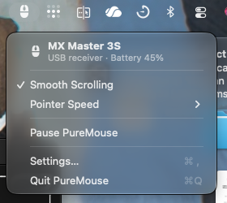

<p align="center">
  <picture>
    <source media="(prefers-color-scheme: dark)" srcset="assets/AppIcon-dark.png">
    
  </picture>
</p>

<h1 align="center">PureMouse</h1>

<p align="center">
  Button mapping, gestures, DPI and smooth scrolling for Logitech mice on macOS.<br>
  Offline, with no account, no telemetry and no dependencies.
</p>

<p align="center">
  <a href="https://github.com/mblauberg/PureMouse/releases/latest"></a>
  <a href="https://github.com/mblauberg/PureMouse/actions/workflows/ci.yml"></a>
  
  
  <a href="LICENSE"></a>
</p>

<p align="center">
  
</p>

## Features

- **Buttons:** Mission Control, App Exposé, Show Desktop, Launchpad, Spaces, back and forward,
  any keyboard shortcut or a shell command.
- **Gestures:** hold the thumb button and move the mouse for four more actions.
- **Smooth scrolling:** pixel-precise and accelerated on both wheels, in step with the display.
- **Hardware:** DPI with presets, wheel direction, ratchet or free-spin, and SmartShift.
- **Reliable:** settings come back after every reconnect and wake. Quitting returns the mouse to
  normal, and nothing is stored on it.
- **Light:** the background process uses about 10 MB and no CPU while the mouse is idle.

Built and tested with the MX Master 3S, over Bluetooth or a Bolt or Unifying receiver. Other
HID++ 2.0 mice should work for the features they have.

## Install

Requires macOS 14 or later, on Apple silicon or Intel.

1. Download `PureMouse-<version>.zip` from the
   [latest release](https://github.com/mblauberg/PureMouse/releases/latest), unzip it and move
   `PureMouse.app` to Applications.
2. PureMouse is not notarised. Clear the quarantine flag **before** opening it (or see
   [Opening a blocked app](docs/troubleshooting.md#opening-a-blocked-app)):

   ```sh
   xattr -dr com.apple.quarantine /Applications/PureMouse.app
   ```

3. Quit Logi Options+ if it is running: both apps try to control the mouse.
4. Open PureMouse. It starts at login from now on and opens Settings.
5. In System Settings › Privacy & Security, allow **Accessibility** (for scrolling, shortcuts and
   swipes) and **Input Monitoring** (for Bluetooth). PureMouse picks up each grant by itself.

To update, quit PureMouse, replace the app and open it again.

## Settings

The menu bar shows the mouse and its battery, and switches smooth scrolling, pointer speed presets
and pause. **Settings…** covers the rest; changes apply as you make them.

<p align="center">
  <picture>
    <source media="(prefers-color-scheme: dark)" srcset="docs/images/settings-buttons-dark.png">
    
  </picture>
</p>

<details>
<summary>Scrolling, pointer and general settings</summary>
<p align="center">
  <picture>
    <source media="(prefers-color-scheme: dark)" srcset="docs/images/settings-scrolling-dark.png">
    
  </picture>
  <picture>
    <source media="(prefers-color-scheme: dark)" srcset="docs/images/settings-pointer-dark.png">
    
  </picture>
  <picture>
    <source media="(prefers-color-scheme: dark)" srcset="docs/images/settings-general-dark.png">
    
  </picture>
</p>
</details>

**Select by Pressing** finds a button by pressing it. Everything is also in
`~/.config/puremouse/config.json`, which applies on save; see [Configuration](docs/configuration.md).

**Quit PureMouse** stops it until the next login. To remove it, run this, then move the app to the
Bin (your config is kept):

```sh
/Applications/PureMouse.app/Contents/MacOS/puremouse unregister
```

## Documentation

- [Configuration](docs/configuration.md): every field, action and gesture
- [Troubleshooting](docs/troubleshooting.md): logs, permissions, Gatekeeper, macOS upgrades
- [How it works](docs/how-it-works.md): the two processes, scrolling, source layout
- [Development](docs/development.md): building, testing, signing and releases

## Licence

MIT. See [`LICENSE`](LICENSE).

PureMouse is an independent project, not affiliated with or endorsed by Logitech. Logitech, Logi,
Logi Options+ and MX Master are trademarks of Logitech.
