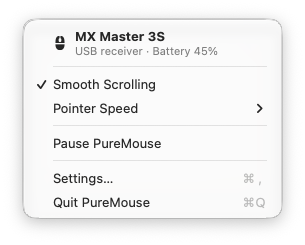
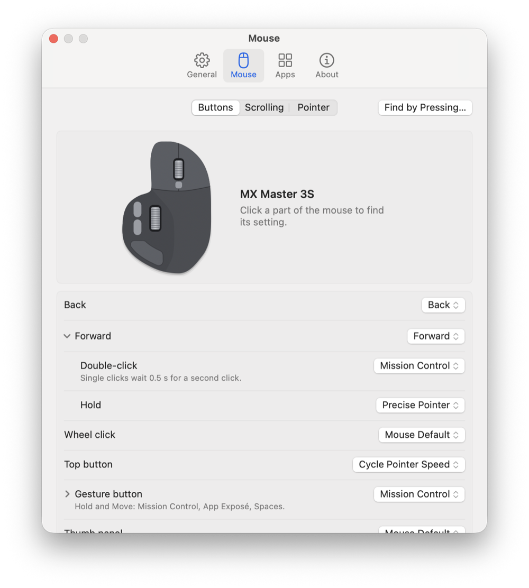
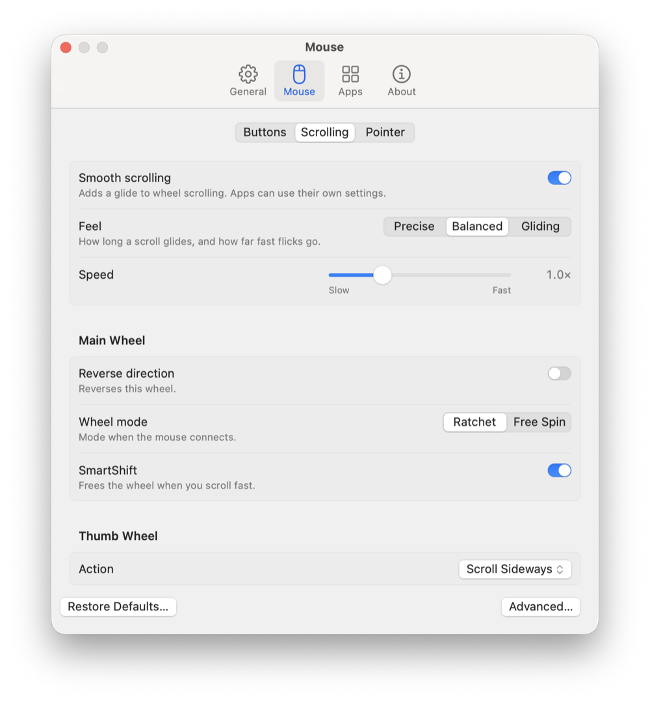
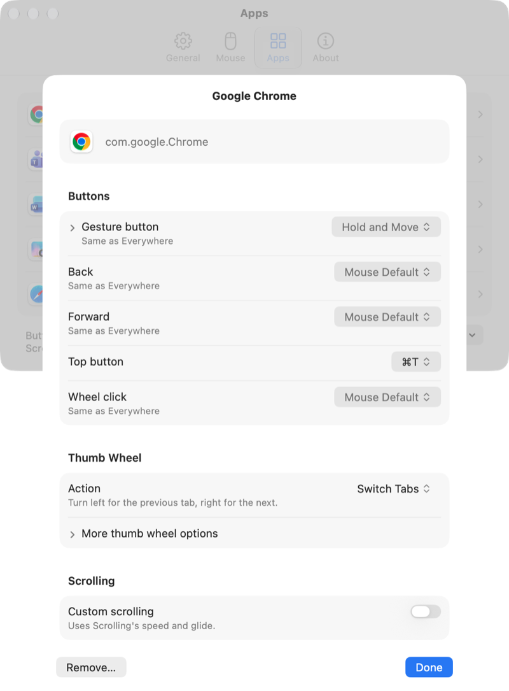
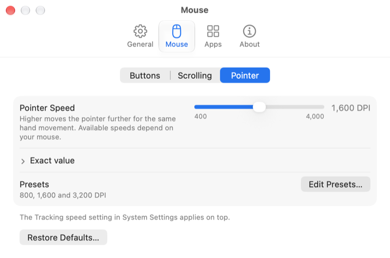
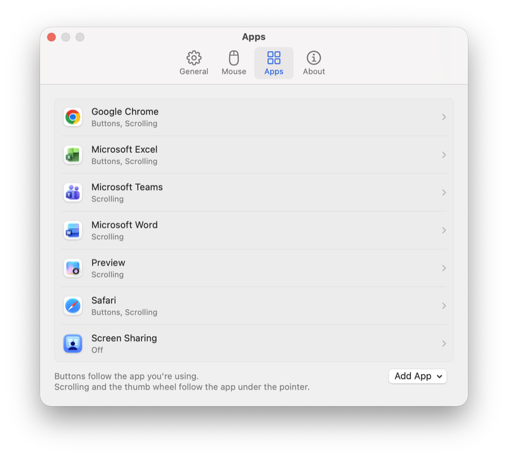
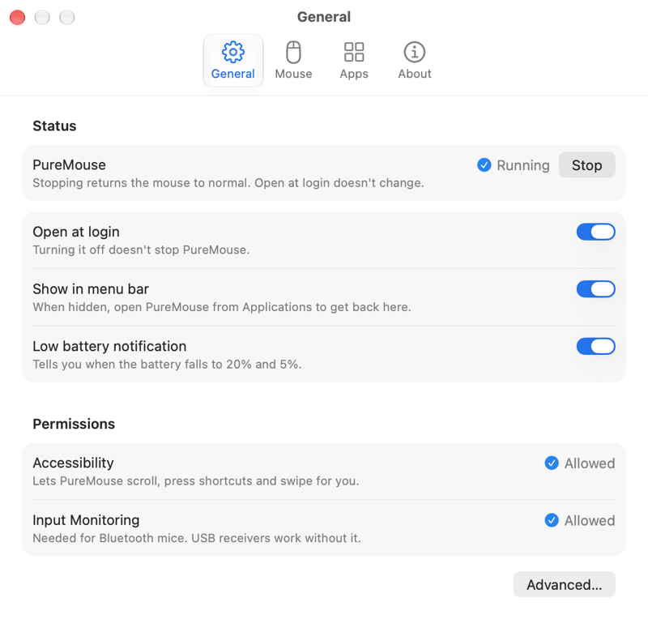
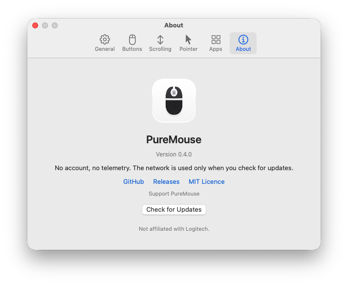

<p align="center">
  <picture>
    <source media="(prefers-color-scheme: dark)" srcset="assets/AppIcon-dark.png">
    
  </picture>
</p>

<h1 align="center">PureMouse</h1>

<p align="center">
  A lightweight, native alternative to Logi Options+ for Logitech mice on macOS.<br>
  Buttons, gestures, smooth scrolling, pointer speed and per-app settings,<br>
  with no account and no telemetry, and idle when your mouse is.
</p>

<p align="center">
  <a href="https://github.com/mblauberg/PureMouse/releases/latest"></a><br>
  <sub>Free · macOS 14 or later · Apple silicon and Intel · signed but not notarised, so see <a href="#install">Install</a> before opening it</sub>
</p>

<p align="center">
  <a href="https://github.com/mblauberg/PureMouse/releases/latest"></a>
  
  <a href="LICENSE"></a>
</p>

<!-- Hero: the menu and Mouse › Buttons. The Buttons shot is replaced with the redesigned Mouse tab
     (#125, device card #56) before 0.6.0; see "Screenshots" below. The current Settings captures
     have no window shadow, so the light ones fade into a white page: take the 0.6.0 set with it. -->
<p align="center">
  <picture>
    <source media="(prefers-color-scheme: dark)" srcset="docs/images/menu-dark.png">
    
  </picture>
  <picture>
    <source media="(prefers-color-scheme: dark)" srcset="docs/images/settings-buttons-dark.png">
    
  </picture>
</p>

PureMouse talks to the mouse directly over Logitech's HID++ protocol, in Swift with no third-party
dependencies.

## Features

### Buttons and gestures

Put every button to work.

- Map the extra buttons (not left or right click) to Mission Control, Spaces, volume, tabs, a
  shortcut or a shell command.
- Hold the gesture button and move the mouse for four more actions.
- **Find by Pressing…** finds a button by pressing it.

### Scrolling

Smooth where you want it, native where you don't.

- Smooth, accelerated scrolling on both wheels: Precise, Balanced, Gliding or your own feel.
- The thumb wheel scrolls sideways, or switches tabs, changes the volume, zooms or moves between
  Spaces.
- Wheel direction, ratchet or free spin, and SmartShift.

### Per app

Each app can work its own way.

- Its own buttons, thumb wheel and scrolling.
- Buttons follow the app you're using; scrolling and the thumb wheel follow the app under the
  pointer.
- Suggestions for common apps: tabs in browsers, volume in Zoom and Teams, zoom in Word.

### Pointer speed and battery

Change speed on the fly, and hear about the battery before it runs out.

- DPI presets you can cycle from a button or the menu.
- Battery in the menu, and a notification at 20% and 5% (needs the menu bar icon).
- If a mouse PureMouse recognises comes back already low, it warns once.

### Stays out of the way

Set it up once, then forget it's there.

- Settings return after every reconnect and wake; quitting hands the mouse back to macOS.
- No settings are saved permanently on the mouse, so it works normally on any other computer.
- **Universal Control:** the wheels and buttons keep working when the pointer moves to another Mac.

## Screenshots

Settings has four tabs, General, Mouse, Apps and About, and each change applies as you make it.

<!-- Mouse tab: the Scrolling and Pointer cells (and the hero's Buttons shot) are replaced with
     captures of the redesigned Mouse tab and its device card (#125, #56) before 0.6.0. Captures
     follow docs/ui-design.md ("Captures"); keep the -light/-dark pairs in docs/images. -->
<table>
  <tr>
    <td width="50%" valign="top">
      <picture>
        <source media="(prefers-color-scheme: dark)" srcset="docs/images/settings-scrolling-dark.png">
        
      </picture>
      <br><sub><b>Mouse › Scrolling.</b> Feel and speed, wheel mode, SmartShift and the thumb wheel.</sub>
    </td>
    <td width="50%" valign="top">
      <picture>
        <source media="(prefers-color-scheme: dark)" srcset="docs/images/settings-app-dark.png">
        
      </picture>
      <br><sub><b>One app.</b> Chrome's own buttons and thumb wheel, beside what it shares with everywhere else.</sub>
    </td>
  </tr>
  <tr>
    <td width="50%" valign="top">
      <picture>
        <source media="(prefers-color-scheme: dark)" srcset="docs/images/settings-pointer-dark.png">
        
      </picture>
      <br><sub><b>Mouse › Pointer.</b> Pointer speed and the presets a button can cycle.</sub>
    </td>
    <td width="50%" valign="top">
      <picture>
        <source media="(prefers-color-scheme: dark)" srcset="docs/images/settings-apps-dark.png">
        
      </picture>
      <br><sub><b>Apps.</b> Every app with settings of its own, and what each one changes.</sub>
    </td>
  </tr>
</table>

<details>
<summary>More screenshots: General and About</summary>
<br>
<table>
  <tr>
    <td width="50%" valign="top">
      <picture>
        <source media="(prefers-color-scheme: dark)" srcset="docs/images/settings-general-dark.png">
        
      </picture>
      <br><sub><b>General.</b> Running and login, the menu bar icon, notifications and permissions.</sub>
    </td>
    <td width="50%" valign="top">
      <picture>
        <source media="(prefers-color-scheme: dark)" srcset="docs/images/settings-about-dark.png">
        
      </picture>
      <br><sub><b>About.</b> Version, Check for Updates and links.</sub>
    </td>
  </tr>
</table>
</details>

## Supported mice

PureMouse works with Logitech mice that speak HID++ 2.0, over Bluetooth or a Logi Bolt or Unifying
receiver. It keeps no list of models: it adopts any mouse or trackball, or any device with
adjustable DPI, and turns on each feature that mouse reports. Keyboards, numpads, presenters and
receivers are left alone.

| Family | What PureMouse turns on |
|---|---|
| MX Master 3, 3S and 4 | Buttons, gestures, DPI, both wheels, SmartShift and battery; haptic feedback on the 4 |
| MX Anywhere 3 and 3S | Buttons, DPI, smooth scrolling, SmartShift and battery |
| MX Vertical and Lift | Buttons, DPI and battery |
| Signature Plus M750 | Buttons, DPI, smooth scrolling on its notched wheel and battery |
| MX Ergo | Buttons, smooth scrolling on its notched wheel and battery |
| G-series, such as the G305 and G Pro X 2 Superstrike | Battery, and DPI where the mouse accepts it |

Tested on hardware: MX Master 3S. The other families are supported from what each mouse reports,
and the test suite runs PureMouse against captured or published replies from several of them.
[Supported mice](docs/supported-mice.md) has the model details, where each comes from and the
limits. Using another Logitech mouse? Share
[`puremouse probe` output](docs/troubleshooting.md#inspecting-a-mouse) in an issue to help verify
its features.

## Lightweight by design

| | PureMouse | Measured on |
|---|---|---|
| Download | 4.9 MB dmg, 12.4 MB installed; universal (Apple silicon and Intel) | 0.5.1, 2026-11-03 |
| Memory: background process | 4.9 MB after 10 hours with an MX Master 3S connected | 0.4.0, 2026-11-03, one reading |
| Memory: menu bar app | About 9 MB fresh, about 14 MB once its menu has been opened | 0.4.0, 2026-11-03, median of 5 runs |
| Memory: Settings | About 36 MB in its own process while its window is open, then nothing | 0.4.0, 2026-11-03, median of 5 runs |
| Idle CPU | Zero in normal use: no polling, no timers, no wake-ups* | By design |
| Processes | Two: the background process and an optional menu bar app, plus Settings while its window is open | By design |
| Network | One small update check a day if you allow it, or when you press **Check for Updates**; an update only when you choose it | By design |
| Privacy | No account, no telemetry, no settings saved permanently on the mouse | By design |

The sizes are the published 0.5.1 release: the dmg as downloaded, and the app inside it counted
file by file (`scripts/check-size.sh`). The memory figures are from macOS 27.0.1 on Apple silicon,
the menu bar app and Settings from the [footprint rig](docs/development.md#footprint-rig), built
from source. Figures move with each release and each macOS, so they are taken again for every
minor release.

The background process uses only system frameworks and no UI toolkit. Settings is a separate app
that runs only while its window is open (it shows in the Dock meanwhile, and quits when you close
it), so the menu bar app stays small. Smooth scrolling runs in step with the display, and only
while the wheel is moving.

<sub>* Three exceptions. The optional daily update check (off until you say yes) is scheduled by
macOS, which picks a convenient moment; PureMouse has no timer for it. The other two are short-lived:
while a permission is still to be granted, PureMouse checks for it with growing gaps for up to ten
minutes; and a Bluetooth mouse that does not answer when it connects is retried once a minute until
it does.</sub>

## Install

Requires macOS 14 or later, on Apple silicon or Intel. PureMouse is signed but not notarised, so
expect macOS to block it the first time; step 2 clears that before you open it.

1. Download `PureMouse-<version>.dmg` from the
   [latest release](https://github.com/mblauberg/PureMouse/releases/latest), open it and drag
   `PureMouse.app` to Applications.
2. **Before** opening it, clear the quarantine flag. Open Terminal and run:

   ```sh
   xattr -dr com.apple.quarantine /Applications/PureMouse.app
   ```

   Opened it already and got a warning? See
   [Opening a blocked app](docs/troubleshooting.md#opening-a-blocked-app).

3. Quit Logi Options+ if it is installed: only one app can control the mouse at a time.
4. Open PureMouse. It opens Settings and starts at login from then on.
5. In System Settings › Privacy & Security, allow **Accessibility** (for scrolling, shortcuts and
   swipes) and **Input Monitoring** (for Bluetooth). PureMouse picks up each grant by itself, and
   Settings › General shows both. [Privacy](docs/privacy.md) says what each one is used for.

### Updating

- **From the menu.** After asking once, PureMouse checks for a new release at most once a day. A
  new release brings one quiet notification, and the menu shows **Update to X.Y.Z…** with **Skip
  This Version** under it. Choosing it asks, then downloads the release, checks it against its
  `SHA256SUMS` and that it is signed by the same certificate as this copy, replaces the app and
  opens it again, with no window if Settings was not open. Settings › About has the same as **Update and Relaunch**, and Settings comes back on About. Quitting PureMouse while it
  runs stops the update. If a check fails, or the app is on a read-only disk or needs an administrator,
  nothing is replaced: the menu says why and links the release page (or opens it), and you update
  by hand. Nothing installs unless you choose it, and the switch in Settings › About turns the
  check, and the row, off. Versions after 0.5.1 have the daily check; in any version, **Check for
  Updates** in Settings › About checks once. [Privacy](docs/privacy.md) has the details.
- **By hand.** Download the new dmg, replace the app in Applications, clear the quarantine flag as
  in step 2 and open it; it replaces the running copy. Your settings and permissions carry over.

### Removing

Run the command below, then move the app to the Bin. Your config stays in `~/.config/puremouse`.

```sh
/Applications/PureMouse.app/Contents/MacOS/puremouse unregister
```

## Privacy and security

No account and no telemetry. PureMouse writes only to your home folder and goes online only to
check for updates (once a day if you allow it, or when you press **Check for Updates**) and to
download one you choose to install.
[Privacy](docs/privacy.md) lists every permission, file and request; [Security](SECURITY.md) says
how to report a vulnerability.

## Documentation

- [Supported mice](docs/supported-mice.md): model details, what each reports and where that comes from
- [Configuration](docs/configuration.md): every field, action and gesture. Prefer a text file?
  Everything is in `~/.config/puremouse/config.json`, which applies when you save it and can give
  each model of mouse its own settings
- [Troubleshooting](docs/troubleshooting.md): logs, permissions, Gatekeeper, macOS upgrades
- [How it works](docs/how-it-works.md): the background process, menu bar app and Settings,
  device support, scrolling, source layout
- [Architecture decisions](docs/adr/README.md): why it is built this way
- [Development](docs/development.md): building, testing, signing and releases
- [Privacy](docs/privacy.md): permissions, files written and the update check

Bug reports and ideas are welcome in [Issues](https://github.com/mblauberg/PureMouse/issues);
[Contributing](CONTRIBUTING.md) explains how to ask for a mouse and how to send a change.

## Support

PureMouse is free and open source. If it's made your mouse nicer to use, you can support it on
[GitHub Sponsors](https://github.com/sponsors/mblauberg). Thank you!

## Licence

MIT. See [`LICENSE`](LICENSE).

PureMouse is an independent project, not affiliated with or endorsed by Logitech. Logitech, Logi,
Logi Options+, Logi Bolt, Unifying and MX Master are trademarks of Logitech.
