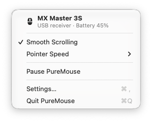
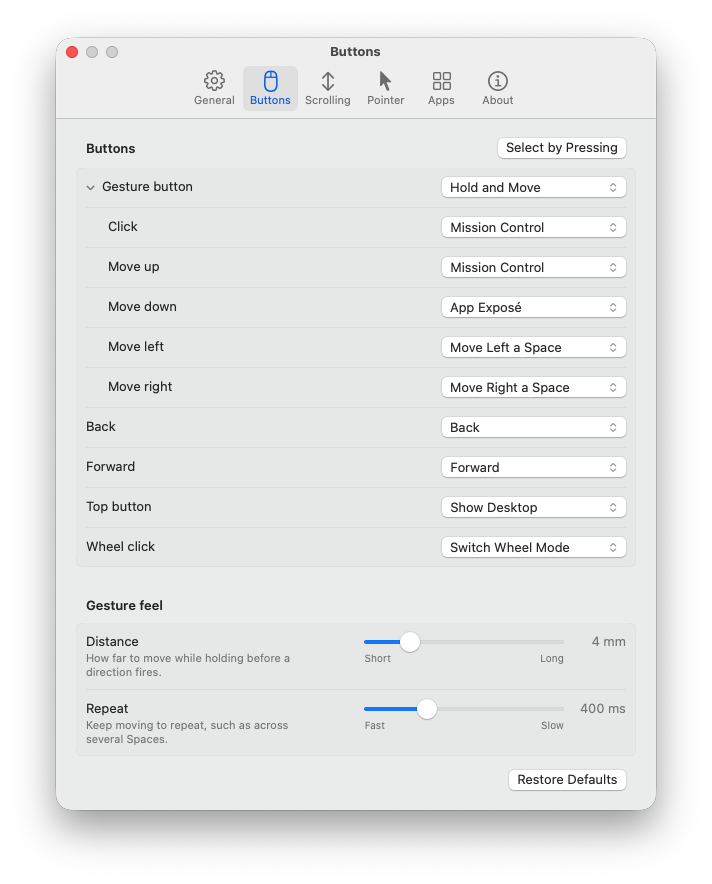
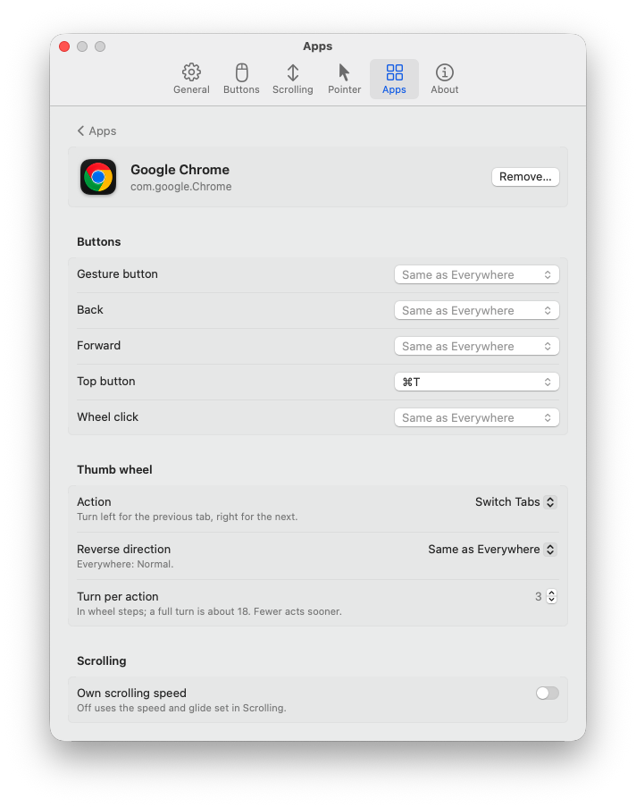
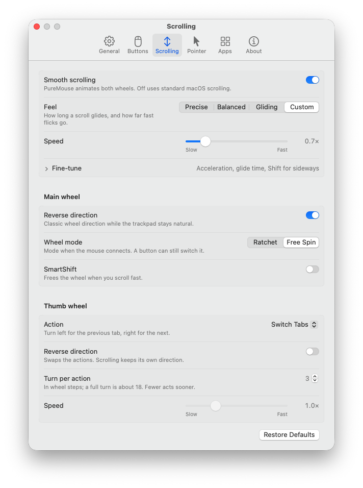
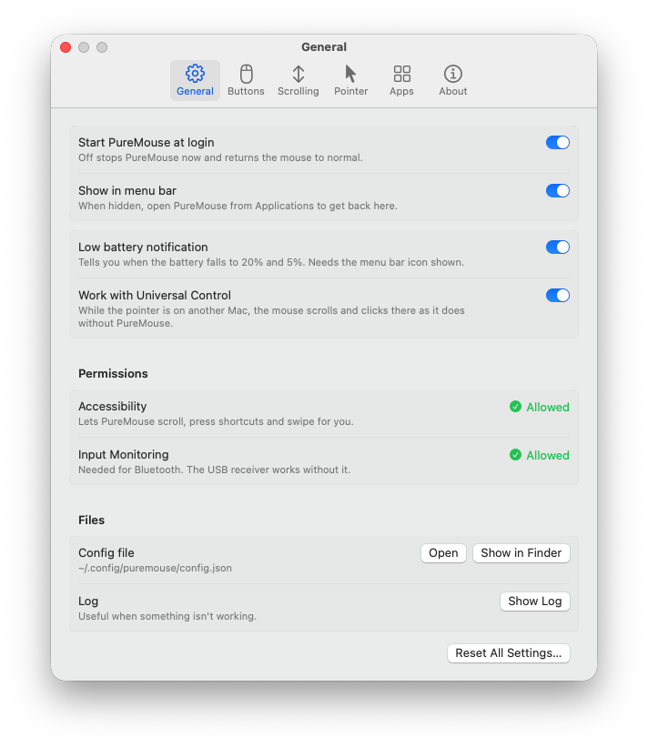
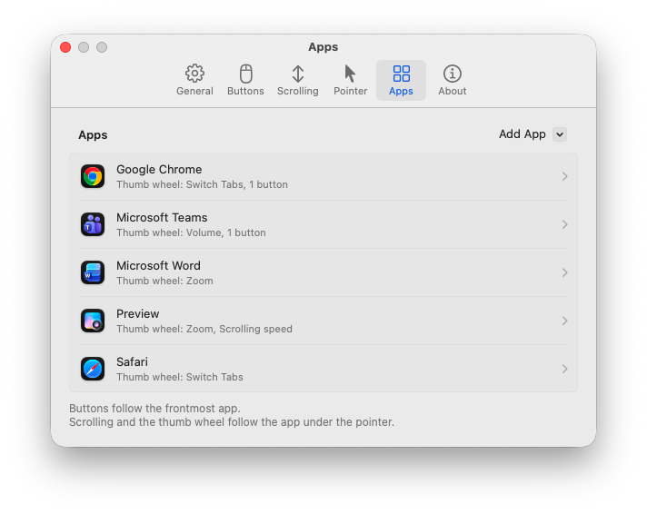
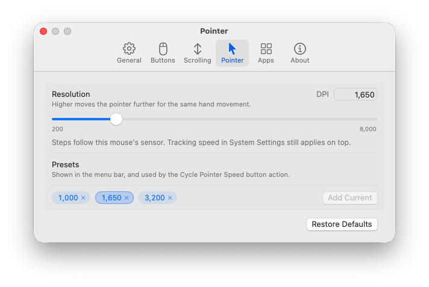

<p align="center">
  <picture>
    <source media="(prefers-color-scheme: dark)" srcset="assets/AppIcon-dark.png">
    
  </picture>
</p>

<h1 align="center">PureMouse</h1>

<p align="center">
  A lightweight, native alternative to Logi Options+ for Logitech MX mice on macOS.<br>
  Buttons, gestures, smooth scrolling, DPI and per-app settings, in under 20 MB of memory.
</p>

<p align="center">
  <a href="https://github.com/mblauberg/PureMouse/releases/latest"></a>
  <a href="https://github.com/mblauberg/PureMouse/actions/workflows/ci.yml"></a>
  
  
  <a href="LICENSE"></a>
</p>

<p align="center">
  <picture>
    <source media="(prefers-color-scheme: dark)" srcset="docs/images/menu-dark.png">
    
  </picture>
</p>

PureMouse talks to the mouse directly over Logitech's HID++ protocol: no account, no cloud sync and
no updater in the background. It is written in Swift with no third-party dependencies, and when
the mouse is idle, so is PureMouse.

## Lightweight by design

| | PureMouse 0.3.0, as measured |
|---|---|
| Download | 5.6 MB zip, 8.4 MB installed; universal (Apple silicon and Intel) |
| Memory | 4-6 MB for the background process, 14 MB for the menu bar app |
| Idle CPU | Zero in normal use: no polling, no timers, no wake-ups* |
| Processes | Two: the background process and an optional menu bar app |
| Network | None, unless you press **Check for Updates** |
| Privacy | No account, no telemetry, nothing stored on the mouse |

The background process uses only system frameworks and no UI toolkit. The menu bar app builds its
Settings window on demand and hands the memory back when you close it. Smooth scrolling runs in
step with the display, and only while the wheel is moving.

<sub>* Two exceptions, both short-lived: while a permission is still to be granted, PureMouse checks
for it with growing gaps for up to ten minutes; and a Bluetooth mouse that does not answer when it
connects is retried once a minute until it does.</sub>

## Features

**Buttons and gestures**
- Map any button to Mission Control, App Exposé, Show Desktop, Launchpad, Spaces, back and
  forward, volume, brightness, tabs, zoom, a keyboard shortcut or a shell command.
- Hold the gesture button and move the mouse for four more actions.
- **Select by Pressing** finds a button by pressing it.

**Scrolling**
- Smooth, accelerated scrolling on both wheels, with Precise, Balanced and Gliding presets or
  your own feel.
- The thumb wheel scrolls sideways, or switches tabs, changes the volume, zooms, moves between
  Spaces or runs two actions of your choice, in whichever direction you prefer.
- Wheel direction, ratchet or free spin, and SmartShift.

**Per app**
- Give an app its own buttons, thumb wheel and scrolling speed. Buttons follow the frontmost app;
  scrolling and the thumb wheel follow the app under the pointer.
- Suggestions for common apps: tab switching in browsers, volume in Zoom and Teams, zoom in Word,
  PowerPoint and Preview.

**Everything else**
- DPI with presets you can cycle from a button or the menu.
- Battery level in the menu, with a notification at 20% and 5%.
- **Universal Control:** when the pointer moves to another Mac, the wheels and buttons carry on
  working there.
- **Check for Updates** in Settings › About, only when you ask.
- Settings return after every reconnect and wake. Quitting hands the mouse straight back to
  macOS, and nothing is written to the mouse, so it behaves normally on any other computer.

## Settings

The menu bar shows the mouse and its battery, and switches smooth scrolling, pointer speed and
pause. **Settings…** covers everything else, and changes apply as you make them.

<p align="center">
  <picture>
    <source media="(prefers-color-scheme: dark)" srcset="docs/images/settings-buttons-dark.png">
    
  </picture>
  <picture>
    <source media="(prefers-color-scheme: dark)" srcset="docs/images/settings-app-dark.png">
    
  </picture>
</p>

<details>
<summary>More settings: scrolling, general, apps and pointer</summary>
<p align="center">
  <picture>
    <source media="(prefers-color-scheme: dark)" srcset="docs/images/settings-scrolling-dark.png">
    
  </picture>
  <picture>
    <source media="(prefers-color-scheme: dark)" srcset="docs/images/settings-general-dark.png">
    
  </picture>
  <picture>
    <source media="(prefers-color-scheme: dark)" srcset="docs/images/settings-apps-dark.png">
    
  </picture>
  <picture>
    <source media="(prefers-color-scheme: dark)" srcset="docs/images/settings-pointer-dark.png">
    
  </picture>
</p>
</details>

Prefer a text file? Everything is also in `~/.config/puremouse/config.json`, which applies as soon
as you save it; see [Configuration](docs/configuration.md).

## Supported mice

PureMouse is developed and tested with the **MX Master 3S**. Rather than relying on a fixed list
of models, it turns on each feature a mouse reports over HID++, so the rest of the MX family is
covered too:

| Mouse | What PureMouse uses |
|---|---|
| MX Master 3S | Buttons, gestures, DPI, both wheels, SmartShift and battery |
| MX Master 3 / 3 for Business | The same, including older firmware's battery reporting |
| MX Master 4 | The same, plus haptic feedback as an action |
| MX Anywhere 3 / 3S | Buttons, DPI, smooth scrolling, SmartShift and battery |
| MX Vertical / Lift | Buttons, DPI and battery |

Bluetooth and Logi Bolt or Unifying receivers are picked up automatically. Using a different
Logitech mouse? Attaching [`puremouse probe` output](docs/troubleshooting.md#inspecting-a-mouse)
to an issue is the quickest way to get it supported.

## Install

Requires macOS 14 or later.

1. Download `PureMouse-<version>.zip` from the
   [latest release](https://github.com/mblauberg/PureMouse/releases/latest), unzip it and move
   `PureMouse.app` to Applications.
2. PureMouse is signed but not notarised, so macOS blocks its first launch. Clear the quarantine
   flag **before** opening it (or see [Opening a blocked app](docs/troubleshooting.md#opening-a-blocked-app)):

   ```sh
   xattr -dr com.apple.quarantine /Applications/PureMouse.app
   ```

3. Quit Logi Options+ if it is installed: only one app can control the mouse at a time.
4. Open PureMouse. It opens Settings and starts at login from then on.
5. In System Settings › Privacy & Security, allow **Accessibility** (for scrolling, shortcuts and
   swipes) and **Input Monitoring** (for Bluetooth). PureMouse picks up each grant by itself, and
   Settings › General shows both.

**Updating:** download the new version, replace the app and open it. Your settings and
permissions carry over.

**Removing:** run the command below, then move the app to the Bin. Your config stays in
`~/.config/puremouse`.

```sh
/Applications/PureMouse.app/Contents/MacOS/puremouse unregister
```

## Documentation

- [Configuration](docs/configuration.md): every field, action and gesture
- [Troubleshooting](docs/troubleshooting.md): logs, permissions, Gatekeeper, macOS upgrades
- [How it works](docs/how-it-works.md): the two processes, scrolling, source layout
- [Development](docs/development.md): building, testing, signing and releases

Bug reports and ideas are welcome in [Issues](https://github.com/mblauberg/PureMouse/issues).

## Licence

MIT. See [`LICENSE`](LICENSE).

PureMouse is an independent project, not affiliated with or endorsed by Logitech. Logitech, Logi,
Logi Options+, Logi Bolt, Unifying and MX Master are trademarks of Logitech.
